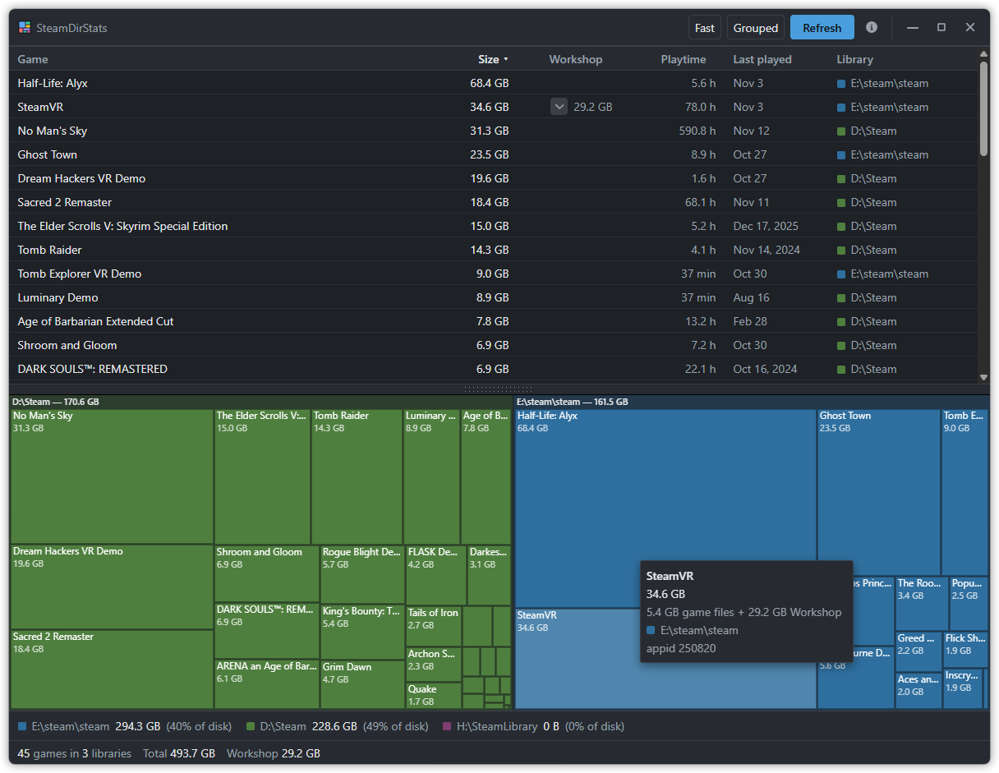

# SteamDirStats

A WinDirStat-style view of the disk space used by installed Steam games, across all your Steam libraries. Useful for managing free space when you have a bunch of games installed on multiple libraries.

<p align="center">
  
</p>

**Features**:

- status bar displays the total space taken by all games across all libraries combined
- the list of games can be sorted by Size, Playtime, Last played, etc.
- view workshop items for a game, by size descending; a "View on Steam Workshop" link takes you to the page in Steam where you can unsubscribe the item
- treemap view to see at a glance games that take the most space, grouped by library or mixed together
- context menu with options:
  - "View Store page" or "View on Steam Workshop" for a Workshop item
  - Browse local files
  - Uninstall (triggers Steam's own Uninstall dialog, where you can confirm/cancel)
- the app does NOT modify or write anything to your Steam folders, only parse data from the libraries

## App Info

- ~6 MB Windows native application built with [Tauri](https://v2.tauri.app/).
- Portable app
  - Settings are saved in the same folder as the executable
  - falling back to `%APPDATA%\SteamDirStats\` when that folder is read-only
- The app works offline, but requires internet connection to look up the full name of Workshop items from a Steam API. Otherwise the items will show up as eg. `Item 3794102006`. The Workshop item names are cached to a local file so the lookup is done only once or for new items.

## Development

The app is developed and built on Windows with Git Bash, no need for WSL.

Requires Node.js 22.18+, Rust and the Microsoft C++ Build Tools.

Quick cheatsheet for the tooling:

- install **Git for Windows** (includes Git Bash) and set a `.bash_profile` `winget install -e --id Git.Git`. Add a profile in **Windows Terminal** for Git Bash for a nice terminal experience
- **Github CLI** `winget install --id GitHub.cli --source winget`
- **VS Code** + *Claude Code for VS Code* extension
- **Claude Code** `winget install Anthropic.ClaudeCode`
- **Node & NPM** `winget install OpenJS.NodeJS.LTS`
- [Visual Studio Build Tools](https://visualstudio.microsoft.com/visual-cpp-build-tools/) required to build app with Tauri (for building the Rust shell)
- **Rust** (for Tauri) `winget install --id Rustlang.Rustup`
- **Python** is often used by Claude Code `winget install Python.Python.3.13`

See [docs/plan.md](docs/plan.md) for the full plan, and [docs/todos.md](docs/todos.md) for the implementation checklist.


```bash
npm install
```

Create the app icons

```bash
npx tauri icon app-icon.png
```

One `package.json` at the project root covers the UI, the CLI and the Tauri
CLI. The Rust side (`src-tauri/`) builds itself on the first `npx tauri dev`.

## Dev & Release Builds

Development, starts the Vite dev server and runs the app in debug mode

```bash
npx tauri dev                        # Vite dev server + the app window, hot reload
```

Run the UI alone, in a browser, on `ui/fixture.json` (instead of the real Steam installation):

```bash
npm run dev
```

Build the app => `src-tauri/target/release/SteamDirStats.exe`

```bash
npx tauri build
```

To screenshot what the window is showing (the page, not the window frame), in
two terminals:

```bash
WEBVIEW2_ADDITIONAL_BROWSER_ARGUMENTS="--remote-debugging-port=9222" npx tauri dev
node tools/shot.mjs window.png       # waits for the window, then writes the PNG
```

Either order works: the script polls for up to 30 seconds.

## Command-line scanner

A CLI version with no build step and no dependencies. Uses the same `core/` the GUI app runs, on the Node host instead of the Tauri one.

```bash
node tools/steamdirstats-cli.ts                     # list games by library
node tools/steamdirstats-cli.ts --json              # same data as JSON
node tools/steamdirstats-cli.ts --accurate          # walk the folders, not the manifests
node tools/steamdirstats-cli.ts --steam-path "D:/Steam"
node tools/steamdirstats-cli.ts --json > ui/fixture.json   # refresh the dev fixture

npm test                                            # node --test over core/
npm run typecheck                                   # all three tsconfigs
```

## Layout

| Folder       | What it holds                                                        |
| ------------ | -------------------------------------------------------------------- |
| `core/`      | All the logic, host-agnostic: no `node:*`, no `@tauri-apps/*`, no DOM |
| `core/hosts/`| The two adapters (`node.ts`, `tauri.ts`) that give `core/` its IO     |
| `ui/`        | The Vue 3 + Vite app                                                  |
| `tools/`     | The CLI and the screenshot helper                                     |
| `src-tauri/` | The Rust shell: six commands and three plugins                       |
